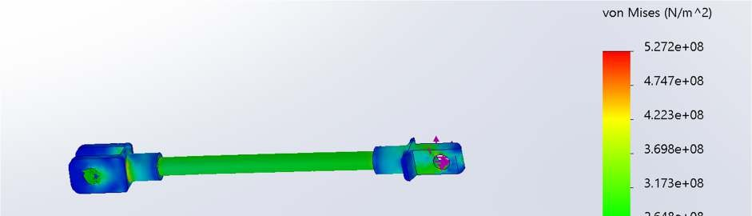
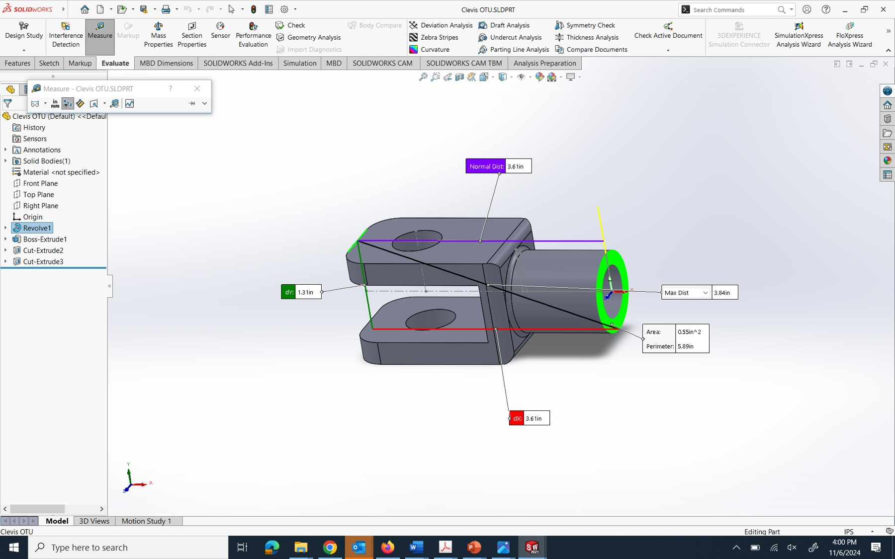
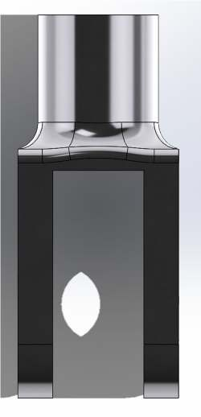

# Finite Element Methods — MATLAB Solvers & FEA Clevis Redesign

Small direct-stiffness FEM solvers written to verify hand calculations, plus the FEA-driven redesign of an insulator clevis assembly they supported.

## MATLAB solvers (`src/`)
| Script | Problem | Method |
|---|---|---|
| `spring_chain_assembly.m` | 3-spring network with a branched node | Assembles the global stiffness matrix, partitions free vs fixed DOFs (`NaN` marks unknowns), solves `K_ff d_f = F_f`, then back-computes reactions `F = K d` |
| `bar_element_solver.m` | Stepped axial bar under nodal loads (5- and 3-element cases) | Banded 1D bar stiffness `AE/L`, fixed-end boundary condition, nodal deflections and element stresses `σ = E·B·d` |
| `space_frame_12dof.m` | 2-node 3D frame element (12 DOF) | Full element stiffness with bending, axial and torsional terms; pseudo-inverse solve where rows are unconstrained |

Run any script in MATLAB or GNU Octave; results print to the console.

## Clevis redesign (SolidWorks Simulation)
Goal: improve the stiffness and safety of a dead-end distribution insulator assembly (clevis, tongue, pultruded-fiberglass rod) **without changing materials**.

- Static study with a refined mesh (growth ratio 1.1, ≈0.023 in minimum element, 15 elements around circular features) to locate stress hotspots at the fillets, tongue hole and rod contact faces.
- Redesign: enlarged fillets (clevis base 0.06 → 0.25 in, top 0.375 → 0.5 in), reworked tongue-hole fillet, reduced chamfers.
- **Factor of safety 0.62 → 1.21 (clevis) and 0.55 → 1.02 (tongue)** for a small mass and cost increase. Ti Grade 2, AISI 4340 and Mg AZ31B compared as material alternatives.

| von Mises stress | Study setup | Redesigned part |
|---|---|---|
|  |  |  |

---
MECE 4290U Finite Element Methods (Fall 2024). Portfolio: [tolujoshlad.wixsite.com/toluwanimi](https://tolujoshlad.wixsite.com/toluwanimi)
